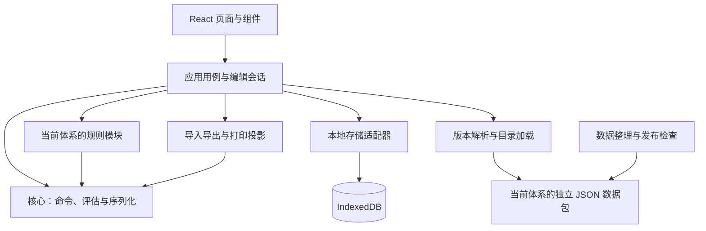

# Battlegroup Army Builder 架构设计

版本：0.2。日期：2026-11-03。状态：M02工程壳及M03领域契约已实现并验收；本文其余运行流程仍是后续模块设计，尚无计价／游戏规则执行或网站部署。实际契约见[M03说明](implementation/m03-contracts.md)。

本文描述系统边界、模块依赖、领域模型和运行流程。[技术方案](technical_plan.md)记录产品目标与总体路线，[实现模块与交付计划](implementation_modules.md)将本文拆成可验收任务。本文细化并更新技术方案中的初步接口与平铺数据示例；具体游戏数值仍以已核对的来源为准。

## 1. 目标与首版边界

项目是免费社区网页版军表编辑器。玩家选择规则体系、国家和军表，购买编制并配置装备，查看 Points、BR 与编制检查，保存、导入、导出和打印军表。

首个可用版本以 Classic Cold War 苏联装甲师 V4.1 为范围，完成“创建 → 购买与配装 → 计算与检查 → 保存恢复 → 导出与打印”。先核对足以组成代表性军表的一组条目，不将完整属性库、全部国家或三套规则同时可用作为前提。界面明确展示当前数据覆盖范围。

长期支持 Classic Cold War、AirLand、NORTHAG；CENTAG 是 NORTHAG 的扩展。首版不实现账户、业务后端、云同步、公共分享库、自定义规则编辑器、跨体系军表转换或对局模拟。离线重新启动网站的能力留待 PWA 阶段，本地保存本身不代表完整离线支持。

## 2. 架构决策与约束

| 决策 | 实现约束 | 原因 |
|---|---|---|
| 一个静态 Web 应用 | React + TypeScript + Vite；初期采用 hash 路由 | 集中维护编辑体验，减少部署时的路由回退依赖 |
| 轻量 workspace | 页面留在 Web；核心与规则代码分包；初期无需独立包发布 | 保持可测试边界，避免先建设插件平台 |
| 三套游戏数据完全隔离 | 分别定义、加载、校验和发布；禁止跨体系引用、继承、别名和差异覆盖 | 同名同属性也属于不同单位 |
| 共享代码，不共享游戏记录 | 可复用树操作、计数算法、类型和组件；阈值、装备、武器、选项与特殊规则分别维护 | 不把 Classic 假设传播到其他规则 |
| 纯函数领域层 | 不访问 React、数据库、网络、当前时间或随机 ID 生成器 | 同一版本、选择和设置产生可复现结果 |
| 保存选择，推导结果 | Points、BR、展开组成、额度和校验来自同一次评估 | 避免界面、保存与打印各算一份 |
| JSON 为运行时数据 | Zod 校验；CSV、OCR 和 PDF 是整理输入 | 保留一个明确的发布数据源 |
| 浏览器本地持久化 | IndexedDB + Dexie；JSON 备份用于转移 | 无账户即可使用，维持低运行成本 |
| 平台适配只在发布层 | 先 Sites 私有测试，之后选择正式静态托管 | 避免测试平台成为业务依赖 |

这些是项目设计选择，不代表已经验证了平台额度、浏览器兼容性或全部规则。依赖版本在工程初始化时锁定；部署能力与访问范围在实际部署时核对。

## 3. 分层与依赖



箭头表示调用或代码依赖。`core` 仅定义规则模块契约及通用工具，不能 import 具体规则模块；Web 的组合入口注册 Classic 等实现并注入评估器。因此图中的规则模块依赖 core，不形成反向循环。不同规则模块之间也不直接依赖。

| 层 | 负责 | 不负责 |
|---|---|---|
| 展示层 | 页面布局、交互、问题定位、详情和打印样式 | 游戏费用公式与限制判断 |
| 应用层 | 打开目录、执行编辑、评估、撤销、自动保存、版本兼容流程 | 在组件中重写规则 |
| 领域核心 | 公共契约、实例树操作、通用计数与费用工具、评估结果协议 | 某套规则的具体阈值和战斗属性定义 |
| 规则模块 | 分区结构、选择条件、计费解释、规则约束、专属统计 | DOM、网络、文件系统与数据库读写 |
| 目录层 | 独立游戏记录、来源、覆盖范围和版本身份 | 任意脚本执行与自动跨体系转换 |
| 基础设施 | 静态资源加载、本地数据库、文件交互、构建部署 | 决定军表是否合法 |

### 3.1 目标目录

```text
apps/web/src/
  app/                         # 路由、依赖装配、页面入口
  features/roster-library/      # 我的军表、创建与复制
  features/roster-editor/       # 编辑用例、命令分发、撤销、视图
  features/catalog-browser/    # 搜索、详情、来源
  features/roster-output/       # 导入导出与打印页面
  adapters/catalog/            # 静态包加载、版本匹配
  adapters/storage/            # Dexie、保存队列、冲突检查
  presentation/rulesets/       # 各体系属性展示适配，不包含计费规则
packages/core/src/
  contracts/                   # Roster、目录外壳、规则接口、结果
  roster/                      # 纯命令与结构检查
  evaluation/                  # 评估管线、费用与计数工具
  serialization/               # 文件外壳、格式迁移、边界检查
packages/rulesets/
  classic-coldwar/src/          # 第一套具体规则及属性 schema
  airland/src/                  # 后续建立
  northag/src/                  # 后续建立
packages/catalogs/
  classic-coldwar/              # 维护用 JSON、来源与发布 manifest
  airland/                     # 后续独立维护
  northag/                     # 后续独立维护，CENTAG 扩展也在此体系内
tools/data-import/             # 候选转换、引用检查、发布目录生成
tests/fixtures/                # 按体系分组的人工样本、未知与冲突样本
tests/integration/             # 核心、数据与适配器组合测试
tests/e2e/                     # 实际浏览器主要流程
docs/
references/                    # 原始资料，不进入静态发布目录
```

只创建本阶段需要的目录。`packages/catalogs` 是数据边界，不要求每个目录都是 npm 包。发布脚本仅从通过检查的 manifest 生成静态目录；`.tmp`、原始 PDF 和整个仓库都不能作为网站资源根目录。

## 4. 领域模型

### 4.1 身份、数据包与来源

完整记录身份至少由 `rulesetId + catalogId + catalogRevision + localId` 确定；独立版本共用稳定 localId 表示同一体系内的记录演进，不表示运行时可混用版本。玩家实例另有 `selectionId`，不能以单位名称、数组序号或 profileId 代替。

例如 Classic、AirLand、NORTHAG 的 T-72 各有自己的记录与来源，即使全部属性相同，也不建立共同装备 ID 或自动同步关系。读取一个体系必须不需要另两个体系的目录。所有引用在当前体系和明确的数据包集合内解析，找不到时不做同名回退。

| 实体 | 主要内容 |
|---|---|
| RulesetDescriptor | 体系身份、支持的规则版本、专属 schema、规模与设置定义 |
| CatalogManifest | 数据包身份、catalogRevision、schemaVersion、基础书版本／印次、勘误集合、rulesRevision、兼容实现、覆盖状态和内容哈希 |
| ArmyList | 国家、具体军表、分区结构入口、可购买条目及适用设置 |
| ArmySection | 分区树节点、可否直接购买、启用条件、作用域限制 |
| UnitEntry | 在具体分区和军表内可购买的定义、费用、组成、选项与规则引用 |
| UnitProfile / WeaponProfile | 当前体系自己的战斗属性；不因属性卡存在就自动赋予购买资格 |
| OptionGroup / Option | 选项组及逐选项上限、目标、计价方式、组成／标签／训练等级变化 |
| Roster / Selection | 玩家设置、版本引用、具体购买及配装选择 |
| SourceReference | 文档身份、PDF 页序、印刷页码、核对状态及必要说明 |
| ErrataRecord | 同体系修订的精确目标、旧值、新值、来源、匹配和应用状态 |

一份军表首期绑定一个发布目录。后续 CENTAG 若组合多个 NORTHAG 包，必须记录全部精确版本及兼容声明；不自动允许不同印次或 Omnibus 记录混入。已应用勘误在构建期生成最终 JSON，运行时无需通用补丁引擎。

来源权威性、人工转录核对状态和勘误应用状态分开记录。官方来源不等于 OCR 数值已核实，社区卡核对准确也不等于它是该军表的合法购买定义。

### 4.2 分区树与购买树

`ArmyStructure` 描述军表的组织分区；`Selection` 的嵌套描述玩家买到的连、排、班和附属单位。二者不能合并为同一棵树。

NORTHAG 资料提示的结构为：Forward Screen、Main Force（下含 Vanguard 与 Main Column）、Additional Fire Support、可选 Reinforcement Requests。这用于检验结构表达能力，具体最小数量和资格仍需核对后才启用强制规则。

顶层购买实例保存 `sectionId`，必须与购买定义一致。子编制继承所属分区，并保留父实例；祖先分区统计由树推导，不重复存储多份归属。相同名称出现在不同购买分区时使用不同 Entry ID，不能按名字共用上限。`category/tag` 仅用于筛选或明确的规则选择器，不能代替分区身份。

每个实例只属于一个父实例或顶层分区，禁止环、孤儿和重复实例 ID。编制内部的固定组成由定义展开；玩家可配置的成员需要稳定目标 ID（例如成员槽位路径和固定成员编号），不能使用随排序变化的数组下标。独立购买的附属条目保留自己的 selectionId。

M03将静态成员路径与独立附件目标分开：静态`member-path`只在当前购买的组成中解析，附属`attachment-member`明确记录`ownerSelectionId + nodePath`。两个同名附件的运输因此可以分别寻址，不随购买顺序变化；限定静态成员槽位的选项不能借附属目标绕过限制。

### 4.3 购买定义、组成与非实体条目

`UnitEntry` 保留现有名称，但不限定为一辆车或一个步兵班。建议用可辨别的 `kind` 区分编制、单体、场外支援、战术资源／请求等实际需要的类型；类型按样本增加。

组成明确区分：已知组成树、明确无需实体、组成待录入。空数组不能同时表达后两种情况。组成树节点记录角色、profile 引用、数量、子节点和可配置槽位。

场外炮击与增援请求允许有费用和规则效果而无 UnitProfile。NORTHAG 请求在静态军表中只表达启用、购买次数、费用和额度；不提前选择未知增援单位，也不预加其到场 BR。未来的请求判定、消耗、到达和动态 BR 属于独立 `BattleState`，当前不创建这一子系统。

### 4.4 选项、计费与统计

每个选项明确以下语义，不能仅保存名称和一个加价数字：

- 目标：整份购买、指定子编制、一个成员或一组稳定成员。
- 变更：增加、移除、替换、训练等级变化、标签变化或资源额度变化。
- 数量：组内总选择数、单个选项次数、目标成员数量分别限制；支持 one each 的逐项约束。
- 费用：一次收取、按目标收取或已声明的分段算法；差额允许为零或负数。
- 作用域：依赖、互斥、Unique 和额度检查作用于当前父编制、分区或全军。

编制基础 Points / BR 采用军表给定值，不能由战斗属性卡或所有子单位的单买价格反推。固定组成标记为包含在父级费用内；额外购买和升级才产生独立费用行。每个费用行有唯一归属键、来源、目标和计费次数，防止子编制展开后再次累计。未知费用使总额不完整；已知零费用仍是完整信息。

评估生成可解释的 `ChargeLine[]`，分别汇总 Points 与 BR。训练等级单独引用当前体系定义：Classic i/r/v/e 与 NORTHAG c/p/e 不共享等级记录，也不自动换算。Classic的e依据基础书PDF第44页及CW延用说明，首批样本仅用i/r不代表体系没有其他等级。规则决定某项升级如何影响 BR，展示层不据训练等级推算 BR。

支援额度使用带作用域的资源账本：明确产生者、消费者、数量和豁免。豁免某池不自动意味着新增另一池。Restricted、Scout 等统计指定计数对象和权重，不能一律按购买次数或模型数累加。需要对手或场景信息的结果显示为条件性提示，缺少必要输入时不做完整合法性结论。

Classic已明确：`Support units`是从对应全军支援分类购买的额度，具体排／连分别提供军表注明的数量；`Platoon Support Options`是该排自己的附属菜单上限。两者独立，例如一个BMP-1排可同时使用4个全军支援选择及4个自身附属选项。局部附属不消耗或产生全军额度，连已含子排也不重复叠加授予；具体类别资格仍按军表规定。该区分于2026-10-30由用户澄清，原A02资料歧义判断已撤回。

### 4.5 未知、不适用与完整性

字段概念上区分 `known(value)`、`unknown(reason)`、`not_applicable(reason)`。数值零属于 known。并非每个字符串都要包成对象，但费用、属性及完整性检查必须保留这些语义。数量上限另外区分有限值、无上限、未知和不适用，不用一个 null 混合表达。

`not_applicable` 仅在相应字段允许时使用，并明确聚合含义；Points、BR 的已知零不能被任意改成“不适用”。属性缺失与组军规则缺失分别报告：若缺少的装甲字段不影响费用或购买资格，可以提示详情不完整，但不因此否定已完整检查的组军结果。

校验结果采用两个独立维度：

- 已确认违规集合：规则 ID、严重程度、原因、关联实例／字段路径、实际值／限值和来源。
- 检查覆盖：费用、结构、购买限制等哪些完成，哪些受未知数据、缺失输入或未实现规则影响。

有已确认强制违规时显示“存在违规”，同时可以显示“检查不完整”。没有违规且所有适用的组军检查完成才显示“在当前版本与设置下合法”；否则显示“无法完整判断”。不把缺失规则简单降为 Warning 后仍显示合法。部分总额明确标记“已知小计”，打印同样保留标记。

## 5. 规则模块与评估流程

### 5.1 契约方向

以下是接口职责示意，不是可直接编译的最终类型。Phase 0 用真实样本确定字段，规则模块内部类型可保留体系差异。

```typescript
interface RulesetModule {
  id: RulesetId;
  supports(identity: CatalogIdentity): CompatibilityResult;
  getStructure(context: ResolvedContext): ArmyStructure;
  evaluate(roster: Roster, context: ResolvedContext): Evaluation;
  getEntryAvailability(
    entryId: EntryId,
    target: PurchaseTarget,
    roster: Roster,
    context: ResolvedContext,
    evaluation: Evaluation
  ): Availability;
}
```

`ResolvedContext` 包含只读的已解析目录、精确版本、ArmyList、显式游戏规模、预算、剧本／阵营身份和启用的可选规则。预算不能自动决定规模。未提供的规则输入保持缺失状态。

`Evaluation` 返回展开后的组成、费用明细与总额、统计／额度、问题与覆盖状态。它带输入 revision 和目录身份，供 UI 拒绝过期结果。`Availability` 区分 allowed、blocked、unknown，并提供原因；待核对条目不可伪装成已确认可购。

技术方案早期的 calculate / validate 是职责划分。本设计使用统一 evaluate 入口共用中间结果，内部仍可拆为独立纯函数，避免同一次编辑中计算与校验使用不同版本或不同展开逻辑。

### 5.2 一次评估

1. 应用层匹配规则模块与精确目录；版本不支持时进入兼容性处理，不以最新包替代。
2. 核心检查结构、引用、规则体系归属、选项目标和数量格式；跨体系或循环结构不能进入正常计算。
3. 规则模块在保留购买层级的基础上应用选择，展开实际组成、有效标签和训练等级。
4. 按明确计费归属生成费用行，产生带完整性状态的 Points / BR。
5. 建立各作用域的计数和资源账本，执行已确认的公共规则与体系专属规则。
6. 汇总问题、未覆盖检查、可展示统计和版本身份，作为唯一评估快照返回。

局部引用缺失时仅评估能够安全解析的部分，并列出被跳过的实例／检查；不得输出完整总额或合法结论。JSON 只允许受支持的规则配置类型，复杂机制使用受测试的 TypeScript 函数，不执行目录中的任意代码。规则组合和派生关系要有明确顺序，不支持没有收敛约束的循环依赖。

## 6. 编辑会话与用户流程

应用层管理三个不同对象：持久化的 RosterDocument、可撤销的编辑会话、可重建的 Evaluation。搜索词、展开面板、弹窗和当前 tab 是 UI 状态，不进入游戏选择。

建议先采用 React reducer/context 管理单军表会话；若实际出现复杂订阅需求再评估 Zustand。领域命令不绑定状态库，包括新增、移除、复制、配置选项、修改预算／规模和备注。时间、UUID 等由应用层生成并作为命令输入。

命令执行原子化：结构不可能成立的操作拒绝；超预算、额度超限等规则违规可以作为草稿保留并立即提示。移除父编制时一并移除其子实例；替换导致选项失效时返回明确的变更清单，不静默留下无效引用或猜测新配装。复制生成新的实例身份，局部选项目标一并重映射。

一次成功命令更新选择和 revision，重新评估，加入有限长度撤销栈，并排队自动保存。撤销／重做也生成新的保存 revision，不能回退数据库并发版本。保存完成只确认对应 revision；旧请求完成不能把仍有新编辑的页面标记为“已保存”。

页面职责：

| 页面／区域 | 内容 |
|---|---|
| 我的军表 | 新建、继续、复制、重命名、导入、删除、全部备份；显示体系与版本 |
| 创建流程 | 仅展示已发布可用目录，选择军表、规模、预算及适用设置 |
| 候选条目 | 按规则分区树组织，显示费用、购买状态与原因，支持搜索 |
| 当前军表 | 购买树与局部配装；编辑目标清晰；撤销删除／批量修改 |
| 汇总与问题 | 同一评估快照的费用、BR、额度、覆盖状态；点击定位 |
| 单位详情 | 当前体系属性展示、训练等级、特殊规则名、来源和待核对信息 |
| 打印 | 独立投影全部选择，不受编辑器折叠状态影响 |

桌面端采用三栏，移动端使用可切换的单栏；不能只靠拖拽完成主要操作，问题定位和配装入口支持键盘及触控。界面文字与领域错误代码分离，先英文界面，保留后续中文词典入口。

## 7. 保存、导入导出与版本

### 7.1 保存契约

`RosterDocument` 保存格式版本、军表 ID／名称、规则及目录精确版本、ArmyList、游戏设置、实例和选项、备注。数据库行另外记录保存 revision、更新时间和摘要。摘要与评估缓存可重建，不作为费用权威来源。

存储端口提供读取、列表、创建、`save(expectedRevision, document)`、删除和备份所需操作。适配器在同一数据库事务内比较 revision 并写入；不匹配则返回 conflict，不能覆盖另一标签页的数据。页面提示重新载入或另存副本；标签页通知是体验补充，事务检查才是正确性保障。

同一军表的保存串行化，快速操作可合并为最新待存快照。失败保留内存选择，持续显示未保存，并提供重试与 JSON 导出。不要依赖页面退出时才保存。首版需实测关闭重开恢复；本地存储不替代用户备份。

### 7.2 文件边界

导出采用带格式版本和目录身份的 JSON 外壳，支持单份军表及全库备份。正常文件以选择为主；可选显示摘要必须标为非权威。导入分为解析、格式与大小／深度／数量限制、引用检查、预览、用户确认写入；不从导入文件指定的任意地址下载数据或执行脚本。

默认导入为新军表，生成新的文档 ID，保留内容语义及实例关系；覆盖必须是用户明确动作。损坏 JSON 或非法结构不进入正常库。结构可读取但目录缺失／版本不支持的文件保留原始文档，可做不兼容备份记录和再次导出，不能强行改成最新版或让用户误以为可以完整计算。

源文件备注和数据说明按文本渲染，不把导入内容当 HTML。打印／导出含规则版本、目录版本、完整性状态和来源标记；浏览器打印负责 PDF 输出，不在首版增加专用 PDF 引擎。

### 7.3 兼容政策

分别管理数据库结构版本、军表文件 schemaVersion、规则 rulesRevision、catalogRevision 以及来源基础版本／勘误集合。首个测试版发布时声明支持集合并保留对应数据及兼容规则实现；不承诺任意历史版本可执行，也不默认测试数据可以被丢弃。

格式迁移只改变表示方式，不能暗中改变游戏规则。游戏数据升级是独立用例：解析原版本，映射同体系记录，展示费用、BR 和选项差异，创建升级副本；无法映射的选择列出待处理项，保留原稿。首版若只有一个版本，先实现准确锁定与不支持时的恢复流程，真正的规则升级器等出现第二个受支持版本再实现。

## 8. 数据整理、发布与部署

数据流为“原始资料 → 候选转录 → 人工核对／歧义登记 → 正式 JSON → schema 与引用检查 → 人工军表回归 → 发布目录”。候选脚本可复跑；正式 JSON 是运行时唯一权威，不同时维护需要手工同步的 CSV 权威副本。

数据检查覆盖 ID 唯一、同体系引用、分区与父子关系、选项作用域、费用状态、规则目标、来源身份和目录覆盖范围。只有核实过的规则才输出强制违规；尚未实现或有歧义的规则保留覆盖缺口，不能悄悄省略。对不影响组军的属性缺口单独说明。

NORTHAG 资料包目前是结构参考和候选输入：旧 manifest 与新提取状态不同，分区命名尚需统一，索引不是可直接购买的完整目录。499 Points 示例的可见 BR 为 58、来源标称 66，只能作为差异处理样本。资料包内指南不改变 Classic 优先的项目顺序；完整性问题见[影响评估](consultations/2026-10-29-northag-design-impact.md)。

构建只发布应用和选定版本目录，可按规则／军表加载，不要求初次打开下载所有体系。首版优先直接同步纯函数评估；用代表性大军表测量后再决定缓存或 Web Worker，无需预先拆服务。

Sites 私有测试对应可追溯的仓库修订和数据版本。后续迁移至 Cloudflare Workers Static Assets 或 GitHub Pages 时主要变更资源基础路径和部署适配；验证子路径、刷新、直接访问、静态数据加载及打印。hash 路由不免除资源路径检查。更换来源时通过导出／导入迁移 IndexedDB 数据。

发布门槛是适用的数据检查、核心测试、浏览器关键流程与构建通过，产物不含原始资料和临时文件。公开数据范围及使用许可按技术方案单独确认；不在文档阶段创建托管项目或宣称发布完成。

## 9. 验证重点与未决问题

| 风险 | 验证方式 |
|---|---|
| 编制与子单位重复计费 | 人工核算编制基础价、单车升级、整组升级、免费替换及负差额 |
| 上限作用域错误 | 同名不同分区、排内局部唯一、全军额度及嵌套选项触发限制 |
| 缺失数据被当成合法 | 未知费用、未核实限制、缺少设置、已知零与不适用字段分别测试 |
| 数据混用 | 独立加载、跨体系引用拒绝、同名不合并、单体系修改不影响其他体系 |
| UI 与结果不一致 | 同一快照驱动汇总、详情提示、导出摘要及完整打印 |
| 丢失用户选择 | 关闭重开、保存失败、连续编辑、旧保存完成、双标签冲突、备份往返 |
| 历史军表被改变 | 版本锁定、不支持版本原稿保留、格式迁移不升级规则 |
| 候选资料误发布 | manifest 覆盖声明、来源核对、发布资源白名单与回归样本审查 |

尚需在 Classic 样本阶段确定：最小条目覆盖、支援额度与升级的计数范围、疑似原文错误处理，以及具体 profile／option schema。NORTHAG 的详细阈值和完整军表留待该体系接入时核实。以上不阻止按[模块计划](implementation_modules.md)推进 Classic 的资料验证与最小闭环。

## 10. 依据

- [技术方案](technical_plan.md)：产品范围、技术路线与三套数据隔离决定。
- [外部咨询核验记录](consultations/2026-10-22-technical-plan-review.md)：已接受的结构建议与被纠正的外部结论。
- [NORTHAG 设计影响评估](consultations/2026-10-29-northag-design-impact.md)：分区树、非实体购买、字段状态和来源边界。
- [NORTHAG 参考包说明](../references/NORTHAG_Soviet_Agent_Reference/README.md)：资料覆盖与候选数据限制；不是正式发布目录。
