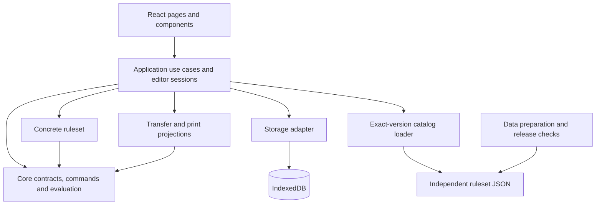

# Battlegroup Army Builder Architecture

Updated: 2026-11-10. Classic editing, local persistence, JSON transfer and printing are implemented. The [deployment guide](deployment.md) records the hosted test site and its source revision. Commands and actual source entry points are in the [development guide](development.md), API responsibilities in [domain contracts](contracts/domain.md), and progress in the [module plan](implementation_modules.md).

This document defines system boundaries, dependencies and domain semantics. The [technical plan](technical_plan.md) describes the product and delivery strategy. Published data and verified source records determine game values; illustrative designs do not override implemented contracts.

## 1. Goal and initial scope

Players select a ruleset, nation and army list; buy formations and equipment; inspect Points, BR and restrictions; save, restore, transfer and print rosters. Classic Cold War Soviet Armoured Division V4.1 is the first supported list. Representative verified entries establish the workflow without requiring every nation, combat attribute or planned ruleset to be complete.

Classic, AirLand and NORTHAG are long-term independent rulesets. CENTAG is a NORTHAG expansion. Accounts, a business backend, cloud sync, public sharing, custom rule editors, cross-ruleset conversion and battle simulation are outside the initial scope. IndexedDB persistence does not by itself provide offline startup; that is a possible later PWA feature.

## 2. Architectural decisions

| Decision | Constraint and rationale |
|---|---|
| One static application | React + TypeScript + Vite, initially with hash routing to reduce hosting rewrite requirements |
| Lightweight workspaces | Keep pages in Web and separate core/ruleset packages; do not build a plugin platform or independent package publishing system first |
| Fully isolated game data | Independently define, load, validate and release each ruleset; prohibit cross-ruleset references, inheritance, aliases and overlays |
| Share code, not game records | Reuse tree operations, counting algorithms, types and components; maintain thresholds, weapons, equipment, options and special rules independently |
| Pure domain layer | No React, database, network, clock or random-ID access; callers supply IDs and revisions |
| Persist choices, derive results | One evaluation supplies composition, charges, totals, statistics and checks |
| Runtime JSON | Zod validates boundaries; CSV, OCR and PDF extraction are preparation inputs, not competing authorities |
| Browser persistence | IndexedDB / Dexie with JSON backups, without an account requirement |
| Hosting adapters at the release boundary | Test on Sites, retain portability to a static host; do not depend on hosting identity or backend services |

These are design constraints, not proof of browser compatibility, platform quotas or complete rule coverage. Verify changing platform capabilities during an actual deployment.

## 3. Layers and dependencies



Arrows indicate calls or code dependencies. Core defines generic protocols and utilities; Web composes concrete rulesets. Core never imports a concrete ruleset, and rulesets do not directly depend on each other.

| Layer | Owns | Excludes |
|---|---|---|
| Presentation | Layout, interaction, issue navigation, details and print styles | Game pricing formulas or legality logic |
| Application | Catalog opening, commands, evaluation, undo, autosave and compatibility workflows | Reimplementing rules inside components |
| Core | Shared contracts, instance operations, generic charging/counting tools and result protocols | Concrete game thresholds or combat schemas |
| Ruleset | Section structure, eligibility, interpretation, constraints and statistics | DOM, network, filesystem or database I/O |
| Catalog | Independent game records, sources, coverage and version identity | Executable scripts or automatic cross-ruleset conversion |
| Infrastructure | Static loading, IndexedDB, file interaction and build/deployment | Deciding whether a roster is legal |

### 3.1 Repository structure

```text
apps/web/src/
  app/                         routing and dependency composition
  components/                  shared presentation components
  features/roster-editor/      sessions, library, roster tree, catalog and details
  features/roster-transfer/    JSON import/export and backups
  features/roster-output/      frozen print projections and PDF preview
  adapters/catalog/            static loading and exact-version matching
  adapters/storage/            Dexie, save queue and conflict handling
packages/core/src/
  contracts/                   identities, catalogs, rosters and result protocols
  validation/                  explicit catalog and roster relation checks
  roster/                      pure commands and structural validation
  evaluation/                  composition, charges, targets and resources
  samples/                     contract-test fixtures; not production catalogs
packages/rulesets/
  classic-coldwar/src/          implemented ruleset and combat-reference schemas
  airland/                     future independent ruleset
  northag/                     future independent ruleset
packages/catalogs/
  classic-coldwar/              immutable releases and reference supplements
  airland/                     future independent data
  northag/                     future data, including compatible CENTAG expansions
tools/data-import/             data and release checks
tests/fixtures/                independent manual expectations
tests/e2e/                     browser workflows
docs/                          maintained documentation
references/                    local, read-only sources; never published
.tmp/                          local evidence and caches; never published
```

Create future directories only when needed. Catalog directories need not be npm packages. Publishing copies only approved runtime assets; neither references, .tmp nor the repository root is a public asset directory.

## 4. Domain model

### 4.1 Identity, catalogs and sources

A record is identified by `rulesetId + catalogId + catalogRevision + localId`. A stable localId can describe evolution inside one ruleset, but does not authorize mixing releases. A player instance has its own selectionId; names, profile IDs and array positions cannot substitute for instance identity.

Classic, AirLand and NORTHAG T-72 records remain unrelated even when all values match. Loading one ruleset must not require another ruleset's catalogs. Resolve every reference inside the declared ruleset and exact catalog set, without name-based fallback.

| Entity | Meaning |
|---|---|
| Ruleset descriptor | Identity, supported rules revisions, schemas, sizes and settings |
| Catalog manifest | Catalog revision, schema/rules versions, source edition, errata, compatible implementation, coverage and content hash |
| ArmyList | Nation, list identity, section root, entries and settings |
| ArmySection | Section-tree node, direct-purchase eligibility, activation and scoped limits |
| UnitEntry | A purchase definition with costs, composition, options and rule references |
| UnitProfile / weapon reference | Combat attributes owned by the current ruleset; a card alone grants no purchase eligibility |
| OptionGroup / Option | Group and per-option limits, targets, charging and effects |
| Roster / Selection | Settings, exact version references and purchased instances/options |
| SourceReference | Source identity, PDF page, printed page and review information |
| ErrataRecord | Exact same-ruleset target, old/new values, source and application status |

Initially a roster binds one published catalog. A future multi-pack NORTHAG/CENTAG roster must identify every exact revision and compatibility declaration; do not silently mix printings or Omnibus records. Apply matching errata at build time to produce final JSON, rather than requiring a generic runtime patch engine.

Source authority, transcription review and errata application are separate dimensions. An official source does not prove an OCR value was checked; a correctly transcribed community card does not make it a legal purchase.

### 4.2 Section tree and purchase tree

ArmyStructure describes list sections; selections describe purchased formations and attachments. They are different trees.

NORTHAG's candidate structure includes Forward Screen, Main Force with Vanguard and Main Column, Additional Fire Support, and optional Reinforcement Requests. This tests representational capability; actual minimum counts and eligibility require source verification before enforcement.

Top-level selections declare a directly purchasable sectionId compatible with the entry. Child selections inherit that section and keep their parent instance. Derive ancestor-section counts instead of storing several independent memberships. Identically named purchases in different contexts use distinct entry IDs and limits. Categories/tags are selectors, not substitutes for section identity.

Reject cycles, orphans and duplicate instance IDs. Expand fixed composition from definitions. Configurable members require stable node paths and declared slots. An independently bought attachment retains its own selectionId.

A `member-path` resolves only inside the current purchase's static composition. An `attachment-member` explicitly carries `ownerSelectionId + nodePath`, relative to that attachment's own composition root. Reordering identical attachments cannot retarget an option. Options restricted to static member slots cannot bypass them through attachment targets.

### 4.3 Purchase definitions and composition

UnitEntry can mean a formation, individual model, off-table support or tactical request; introduce discriminated kinds only as real samples require. Distinguish known composition, explicitly no entities and pending composition. An empty array cannot mean both of the latter states.

Composition records roles, profiles, quantities, children and configurable slots. Off-table support and requests can have costs and effects without a combat profile. Static NORTHAG requests represent enablement, purchases, costs and allowances; do not select unknown future arrivals or add their future BR. Rolls, consumption, arrival and changing BR would belong to a separate BattleState, outside this product's current scope.

### 4.4 Options, charges and statistics

Specify each option's target, effect, quantity limits, charge mode and scope. Group totals, an individual option's limit and the number of targeted members are independent. Support one-each declarations with explicit per-option limits. Effects include additions, removal, replacement, training/tag changes and resource changes. Charge once or per target as declared; zero and negative deltas are valid.

Use printed formation Points / BR, not the sum of independently purchased children or inferred combat values. Fixed members are included in the parent price. Additional purchases/upgrades create distinct ChargeLines with stable attribution, source, target and charged count. Unknown costs make totals incomplete; known zero does not.

Training and numeric BR are independent. Classic i/r/v/e and NORTHAG c/p/e are ruleset-specific records, not automatic conversions. Classic includes Elite even though initial fixtures use only i/r. An option's declared BR effect determines the change; presentation does not derive it from training.

Resource ledgers identify producers, consumers, quantity, scope and exemptions. An exemption from one pool creates no additional pool. Restricted, Scout and similar statistics specify the counting object and weight rather than always counting purchases or models. Missing opponent/scenario inputs limit conclusions.

Classic distinguishes army-wide Support units choices from each platoon's own Platoon Support Options. A BMP-1 platoon can use four of each independently. Local attachments neither consume nor generate army-wide choices, and fixed company platoons do not grant army choices a second time. Category eligibility remains defined by the list. See the [constraints](data/classic-constraints.md) for exact counts and the user-confirmed interpretation.

### 4.5 Unknown values and completeness

Distinguish `known(value)`, `unknown(reason)` and `not_applicable(reason)`. Zero is known. Quantity limits additionally distinguish limited, unlimited, unknown and not applicable. A single null must not encode all these meanings.

Use not_applicable only where permitted, with explicit aggregation semantics. Do not relabel zero Points or BR as not applicable. A missing armor value can make unit details incomplete without invalidating an otherwise complete purchase check; combat-reference gaps and roster-legality gaps are separate.

An evaluation has two independent dimensions:

- Confirmed issues: stable rule ID, severity, reason, purchase/member location, actual/limit and source.
- Coverage: which checks ran, and which are unimplemented, blocked by unknown data or missing input.

Confirmed mandatory violations yield an internal violation conclusion, even alongside partial coverage. Only all applicable checks with no violations can justify full legality under the declared version/settings. Otherwise retain an internal undetermined conclusion and clearly label known subtotals. Coverage remains evaluation metadata for tests and developer inspection. Player pages and printing show the Problems list, without displaying coverage records, completeness declarations or a full-legality claim.

## 5. Ruleset modules and evaluation

### 5.1 Responsibilities

Core exports pure commands and generic evaluation tools; concrete rulesets supply game semantics. Current entry points include `createRosterDocument`, `executeRosterCommands`, `evaluateRoster`, `evaluateClassicRoster`, `resolveChoiceTargets`, `allocateResources` and `getClassicEntryAvailability`. See [domain contracts](contracts/domain.md) for the authoritative responsibility split; early calculate/validate sketches are not current API declarations.

Context supplies a read-only, validated exact release, list and explicit settings. Budget does not silently select game size. Availability distinguishes allowed, allowed-with-issues, blocked and unknown. Rule violations may be retained as draft purchases; invalid references or impossible targets remain blocked.

### 5.2 One evaluation

1. Resolve a compatible ruleset and exact catalog; unavailable versions enter recovery rather than substitution.
2. Validate structure, references, ruleset ownership, member targets and quantities.
3. Apply choices and expand composition, tags and training while preserving purchase ownership.
4. Generate attributed charge lines and independent Points / BR completeness.
5. Build scoped counts/resource ledgers and execute supported generic and concrete rules.
6. Return composition, totals, statistics, issues, coverage and input/version identity as one snapshot.

Safely resolvable subsets may be evaluated when a local reference is unavailable, but skipped inputs must remain explicit and cannot produce a complete-total or legal claim. JSON declares supported configuration; tested TypeScript implements complex mechanisms. Do not execute arbitrary catalog code or allow unbounded cyclic derivations.

## 6. Editing sessions and UI

Keep the persisted RosterDocument, undoable editing session and derived Evaluation separate. Search, expansion, dialogs, selected member and current panel are presentation state. UUIDs/time come from callers; domain operations do not depend on a state library.

Commands are atomic. Reject structurally impossible changes, while retaining over-budget and other rule-breaking drafts with current Problems feedback. Do not show purchase-preview warning banners. Removing a parent removes its descendants. Copying generates new instance identities and remaps local targets. Invalidated choices receive explicit notices rather than guessed replacements.

A successful edit updates choices/revision, reevaluates, enters bounded history and queues saving. Undo/redo creates a fresh edit revision; storage concurrency revisions never roll back. A completed save acknowledges only its own input revision.

Desktop has two columns: the roster on the left, and either add candidates or selected-unit details/options on the right. Fixed platoons and their attachments stay in the left roster; attachments never create a third column. On small screens use Roster / Actions switching. Support keyboard/touch operation without requiring dragging. Keep English UI strings separate from domain error codes for later translation.

My Rosters handles creation, opening, import, export, backup and deletion. The editor shows exact versions, totals, issues, selected-unit data and save state. Print is a separate frozen projection of every purchase, independent of collapsed editor branches. Debug examples and engineering records are opt-in rather than ordinary product content.

### Shared roster overview

The editor and print sheet share a four-card summary: Points with budget,
remaining amount on one line; BR; Officers; Scouts. Statistics come from the
current evaluation's common officers/scout-weight IDs, with each ruleset owning
its calculation. Unknown statistics are not inferred as zero. Section headings
show selected top-level purchases and applicable shared-choice usage/allowance,
without exposing raw resource IDs. Display allowance accounts for other
sections through the canonical resource allocator. Exempt selections count as
purchases without consuming a choice. The former support/statistics panel is
not a separate user-facing area.

## 7. Persistence, transfer and versions

### 7.1 Saving

RosterDocument stores format, identity/name, exact catalog reference, list/settings, selections/options and notes. Database rows additionally have storage revision, update time and rebuildable summary. Derived totals are never authoritative stored state.

The storage adapter compares the page-known expected save revision and writes/deletes in one transaction. Conflicts retain the draft and offer reload or save-as-copy. Notifications supplement correctness; the transaction is decisive. Tombstones stop stale tabs from recreating deleted rosters.

Serialize writes per roster and coalesce pending edits. Failures retain memory choices, report unsaved state and offer retry/recovery JSON. Do not rely on unload-time saving. Verify real browser reopen behavior. Local storage does not replace backups.

### 7.2 Files

[Import/export contracts](contracts/import-export.md) define single-roster and library envelopes, size/depth/count limits, preview-before-write, copy/overwrite semantics and unknown-version recovery. Reject arbitrary URL loading and executable content. Notes and catalog strings render as text.

Default imports create a new roster while preserving internal relationships and exact game versions. Explicit overwrite uses the save queue's last acknowledged, page-known revision after pending writes settle, never a fresh database read that authorizes another tab's changes. Full backups import atomically; error records reject the whole batch. Unsupported originals remain recoverable, not silently converted.

[Printing](contracts/printing.md) uses browser print/PDF, exact versions and one evaluation. Missing data and partial totals remain visible. Optional data appendices are presentation settings, not roster edits.

### 7.3 Compatibility

Manage database schema, roster/file format, catalog schema, rules revision, catalog revision, source edition and errata set independently. Supported historical execution requires retained catalogs, compatible implementations and independent expectations, not merely saved version strings.

Format migration changes representation, not game rules. A future user-requested data upgrade must compare cost/BR/options, produce an upgraded copy, list unmapped choices and retain the original. The current implementation supports exact 1.0.0 and 1.1.0 releases; it does not automatically upgrade between them.

## 8. Data preparation and deployment

Flow: original source → candidate transcription → visual verification / clarification register → formal JSON → schema and relation checks → independent roster regression → immutable indexed release. JSON is the runtime authority; do not maintain a second manually synchronized CSV authority.

Check IDs, same-ruleset references, sections/parents, option scopes, costs, targets, source identity and coverage. Enforce only confirmed rules. NORTHAG preparation has distinct candidate inputs and unresolved reconciliation work; see [NORTHAG notes](data/northag-notes.md). The visible 499 Points / 58 BR versus claimed 66 BR example is a discrepancy fixture, not a golden legal roster.

Publish only selected runtime releases and reference supplements. Start with synchronous pure evaluation; measure real large rosters before adding workers/caches. Keep Sites source snapshots traceable to the main checkout. Migration to another host primarily affects deployment and asset bases; verify subpaths, refresh, deep links, catalog loading and printing. Transfer origin-bound IndexedDB data through backups.

Run applicable data, domain, browser and build checks before a release. Distinguish local validation, hosted deployment and hosted browser verification. See [deployment](deployment.md) for the existing site and update boundary.

## 9. Verification priorities

| Risk | Evidence |
|---|---|
| Double charging | Independent formation, whole-group, per-target, free and negative-delta accounts |
| Wrong limit scope | Different sections, sibling platoons, nested triggers and army-wide resource checks |
| Unknown treated as legal | Separate unknown cost, missing setting, unimplemented rule, known zero and not-applicable cases |
| Data mixing | Independent loading, cross-ruleset rejection and unchanged unrelated ruleset results |
| UI/output divergence | One snapshot for totals, details, issues and full printing |
| Lost choices | Reopen, failed saves, rapid edits, stale acknowledgements, two-tab conflicts and backup round trips |
| Historical roster mutation | Exact-version restore, unsupported-original recovery and format-only migrations |
| Candidate data published | Explicit release assets, coverage/source records and fixture review |

Classic source clarifications A01–A07 and A09 are resolved; A08 remains a scoped coverage question rather than a blanket blocker. NORTHAG thresholds and complete list facts require their own source audit.

## 10. Related documentation

- [Technical plan](technical_plan.md): product and delivery strategy.
- [Domain contracts](contracts/domain.md): current API and integrity boundaries.
- [Classic constraints](data/classic-constraints.md): verified rule semantics.
- [NORTHAG preparation](data/northag-notes.md): source editions and independent implementation requirements.
