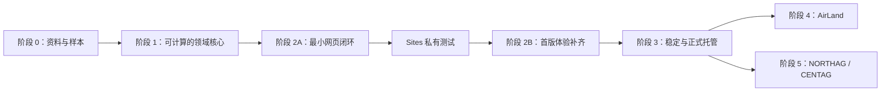

# 实现模块与交付计划

版本：0.9。日期：2026-11-07。状态：M01–M09 已实现并验证。Classic 编辑器使用苏联装甲师 V4.1 目录 1.1.0，包含 151 个购买记录及 203 个配装选项。编制验收见[苏联 V4.1 编制验收](implementation/soviet-v41-formations-acceptance.md)，本地自动保存、恢复与冲突处理见[M09 验收](implementation/m09-acceptance.md)。M10–M12 待实现。

依据[架构设计](architecture.md)和[技术方案](technical_plan.md)。模块是职责与验收单位，不等于服务、独立仓库或 npm 发布包。先完成 Classic 的可用闭环，再接入其他规则；不一次性搭建所有目录和抽象。

## 1. 模块总览

| ID | 模块 | 主要位置 | 首版范围 | 主要依赖 |
|---|---|---|---|---|
| M01 | 资料核对与覆盖基线 | docs/data、tests/fixtures | Classic 代表性编制、来源、歧义、手算样本 | 无 |
| M02 | 工程与构建基础 | 根配置、apps/web | workspace、TS、Vite、检查与静态构建 | 无 |
| M03 | 领域契约与 schema | packages/core/contracts | 分区、购买、选项、文件、评估协议 | M01、M02 |
| M04 | 目录整理与版本加载 | packages/catalogs、tools、Web catalog adapter | Classic JSON、发布检查、精确版本解析 | M03 |
| M05 | 军表命令与编制树 | packages/core/roster | 增删改复制、结构检查、稳定选项目标 | M03 |
| M06 | 评估与通用规则工具 | packages/core/evaluation | 费用明细、作用域计数、额度、完整性 | M03、M05 |
| M07 | Classic 规则模块 | packages/rulesets/classic-coldwar | 已确认样本规则、设置、结构与统计 | M01、M04、M06 |
| M08 | Web 编辑与查询 | apps/web/features、presentation | 我的军表、编辑器、详情、问题定位 | M04、M05、M07 |
| M09 | 本地保存与恢复 | apps/web/adapters/storage | 自动保存、冲突检查、撤销会话衔接 | M03、M05 |
| M10 | 导入导出与兼容处理 | core/serialization、Web roster-output | JSON、备份、预览、不兼容原稿保留 | M03、M04、M09 |
| M11 | 打印与 PDF 视图 | apps/web/features/roster-output | 完整军表、配装、版本与不完整标记 | M07、M08 |
| M12 | 组合验收与部署 | tests/integration、tests/e2e、部署配置 | 真实闭环验证、Sites 私有测试 | M04–M11 |
| M13 | AirLand 接入 | rulesets/airland、catalogs/airland | 后续独立资料与规则 | Classic 闭环稳定、对应资料 |
| M14 | NORTHAG / CENTAG 接入 | rulesets/northag、catalogs/northag | 后续独立分区规则和数据 | Classic 闭环稳定、对应资料 |

M12 的测试设施和用例随各模块建立，最终阶段只是组合验收；不把测试都推到最后。M03–M07 按一个真实样本迭代契约，不先冻结万能 schema 再尝试填充所有资料。

## 2. 各模块实现内容与验收

### M01 资料核对与覆盖基线

**交付物：** Classic首批覆盖、约束、解释记录及人工fixture。已形成[基线](data/classic-sample-scope.md)与[23份核算样本](../tests/fixtures/classic-coldwar/README.md)：四份组合账目、十份局部样本、两份独立支援额度样本及七份用户澄清后的边界样本。主样本398 Points / 23 BR。来源与算术可独立检查，不代表规则引擎已实现。

**当前验收边界：** A01/A02/A03/A04/A07/A09按用户解释解决。仅A05/A06在开放对应升级／组合前明确，不阻塞当前样本范围；A08仅说明覆盖范围，不是已发现的缺失规则。M01当前范围可收尾并推进M02/M03，不承诺完整军表及规则引擎已经实现。

**同日补查及纠正：** 已核对基础书相关章节，新增C19–C25。用户随后明确Support units是全军支援购买额度，Platoon Support Options是排内自身菜单；A02原判断撤回，C07/C08已修正，新增S01/S02边界账目，合计16份。A08的基础书查阅缺口也已补查，剩余仅为具体规则覆盖核对。见[基础书核对记录](data/classic-base-rulebook-review.md)。

任务：

- 选择坦克排／连、BMP 步兵编制、排内支援、独立支援和场外火力，覆盖实际模型差异。
- 逐项记录 Points、BR、组成、升级目标、选项数量、支援产生／消耗与限制来源。
- PDF 文本用于定位；选项跨栏、删除线和疑似错误对照原页核查。
- 为每个歧义记录候选解释、受影响条目及是否阻断某项验证，不编造确定答案。
- 明确哪些条目足以组成代表性军表，哪些仅作建模样本，哪些暂不开放。

**验收：** 至少一份覆盖范围内可人工确认的军表及其非法变体；费用逐项可追溯。若缺失强制条目或关键规则，基线仍处于不完整状态，不宣称正式合法军表。NORTHAG 499/58/66 样例不能充当 Classic 或 NORTHAG 的合法基准。

### M02 工程与构建基础

**状态：已验收，2026-10-31。** 外部任务`t20261030152231-8a652458` revision 1 / a1完成，主Agent独立核验依赖复装、类型检查、7项单测、构建、5项系统Chrome浏览器检查与子路径资源引用。详见[验收记录](implementation/m02-acceptance.md)。当时验收后暂停；用户于2026-11-03另行恢复M03。

**交付物：** workspace 与依赖锁文件、Web 壳、类型检查、Vitest、基础 Playwright 配置、静态构建入口。

任务：建立 core → ruleset → Web 的单向依赖；初始化 React/TypeScript/Vite；配置资源基础路径与 hash 路由；保留英文界面词典入口。具体版本在初始化时确认，不引入服务端或第三方身份。

**验收：** Web 壳能启动并构建；core 和规则包在没有浏览器的测试环境中可运行；发布目录不包含 references 或 .tmp。实际命令随 package scripts 固化到开发说明，不在代码尚未建立时声称某命令已通过。

### M03 领域契约与 schema

**状态：已验收，2026-11-03。** 外部初版需返工，第二轮因GLM额度中断；用户随后授权主Agent接手。完成稳定附属目标、精确身份／分区／来源检查、基础训练及编辑revision契约，依赖复装、类型检查、144项单测、5项Chrome测试、构建和M01账目通过。见[验收记录](implementation/m03-acceptance.md)及[公开契约说明](implementation/m03-contracts.md)。没有计价／游戏规则引擎；验收后暂停，不启动M04。

**交付物：** RosterDocument、Selection、ArmyStructure、目录外壳、选项、来源、版本与 Evaluation 契约；相应 Zod 边界校验。

任务：

- 区分分区树和购买树；定义稳定实例／成员目标和明确费用归属。
- 支持嵌套组成、明确无实体的购买、组成待录入等不同状态。
- 定义 known / unknown / not_applicable，以及限制的有限／无上限状态。
- 把战斗属性 schema 与训练等级留给具体规则模块；不建立共享装备数据库。
- 明确规则 ID、问题定位路径、覆盖状态和可用性结果。

**验收：** M01 样本可表达，非法引用和不可能的结构被拒绝；合成的三个体系同名同属性条目仍有独立身份。合成样本只验证隔离机制，不代表其他规则数据已实现。NORTHAG 分区树、one each 与无实体购买可作契约边界样本，不填入未核对的真实阈值。

### M04 目录整理与版本加载

**状态：已实现并验证，2026-11-03。** Classic首批10个核心条目、独立JSON／精确索引、购买上下文、指纹及来源检查、Web加载状态与子路径支持。目录仍为partial；不把资料覆盖当规则引擎覆盖。见[M04验收](implementation/m04-acceptance.md)。

**交付物：** 独立 Classic JSON 目录、manifest、来源记录、构建期数据检查、静态目录加载器与兼容性结果。

任务：

- 从 M01 整理候选数据，人工核对后形成唯一正式 JSON；避免 CSV 与 JSON 双重权威。
- 检查 ID、同体系引用、分区、组成、选项、规则目标和覆盖缺口。
- 发布身份记录来源版次、勘误集合、schema、规则与目录修订；发布内容保持不可变。
- 加载只接受应用索引中的数据包，校验身份／结构，缺失或版本不支持时返回明确结果。
- 按需加载当前军表所需数据；目录缺失不触发名称匹配或最新版本替代。

**验收：** Classic 包单独可解析；跨体系引用失败；改动某体系不影响其他体系样本；失败状态可被应用区分。已知零费用、未知费用和属性缺口正确保留。发布覆盖声明与实际条目／规则一致。

### M05 军表命令与编制树

**状态：已实现并验证，2026-11-03。** 纯命令、原子批量、调用者ID／revision、子树复制及目标重映射、删除／替换的失效提示、购买上下文结构检查。允许游戏违规草稿，未实现计价或UI。见[M05验收](implementation/m05-acceptance.md)。

**交付物：** 无 UI 依赖的纯命令函数、结构检查和命令结果协议。

任务：实现新增／删除／复制购买、修改配装、预算和设置、原子批量变更；目标稳定 ID；父编制删除与替换后的选项处理；拒绝结构损坏但允许规则违规草稿。UUID 与时间由调用方提供。

**验收：** 连中某排的升级不影响邻排；重排不改变成员目标；复制不共享可变选择；移除父实例无孤儿；失败命令不部分写入。替换失效选项有可见结果，不静默保留或擅自换装。

### M06 评估与通用规则工具

**状态：已实现并验证，2026-11-03。** 统一费用及派生组成快照、live all目标、覆盖状态、作用域选项限制与资源匹配。23份M01费用均吻合，197项单测及构建通过；游戏专属合法性由M07负责。见[M06验收](implementation/m06-acceptance.md)。

**交付物：** 统一评估管线、费用行工具、作用域计数器、资源账本、校验与完整性合并。

任务：支持购买基础价、包含在基础价中的成员、额外子条目、按组／成员收取的差额及 BR 变化；按样本需要实现数量、前置、互斥、额度与唯一性工具。复杂特殊机制保留函数扩展，不构建任意 DSL。

**验收：** 独立手算结果吻合；嵌套不重复计价；负差额、免费替换和零 BR 正确；未知费用只产生已知小计；范围不同的唯一性和额度互不串用。输入一致时结果一致；未覆盖规则使合法性结论不完整。

### M07 Classic 规则模块

**状态：已实现并验证，2026-11-03。** 初始目录的预算／支援／局部唯一性、Restricted／Unique、显式规模及统计接入统一评估；PT-76、场景／TOC等未开放数据用合成边界测试，未知信息保留覆盖缺口。218项单测及构建通过，见[M07验收](implementation/m07-acceptance.md)。

**交付物：** Classic 模块实现、属性 schema、规模／剧本设置、样本规则和体系专属统计。

任务：把 M01 已确认的编制结构、支援额度、Restricted / Unique、场景限制和嵌套选项触发条件接入 M06。训练等级独立于数值 BR；按实际条目定义购买资格。PT-76按已确认A07实现；A05、MANPADS的A06等仍未明确的组合不自动转成确定限制。

**验收：** 基线军表费用／BR 与手算一致；每条已启用规则有适用、违反及边界样本；问题能定位到购买或选项并给出来源；未实现限制出现在覆盖缺口中。此模块完成不表示完整 Classic 军表已经全部录入。

### M08 Web 编辑与查询

**状态：已实现并验证，2026-11-03。** 会话军表列表、创建／示例、目录搜索与资格说明、编制和附件购买、成员配装、费用／组成／规则快照、问题定位及50步撤销／重做。桌面和360像素小屏实际编辑通过；220项单测、类型检查、生产构建及6项Chrome回归通过。刷新会清空当前会话，未伪装成本地保存。见[M08验收](implementation/m08-acceptance.md)。

**交付物：** 我的军表、创建流程、三栏／移动单栏编辑器、详情和可定位的校验面板。

任务：应用层装配目录与规则模块，调度命令和同一份 Evaluation；显示可购／不可购／未知原因、独立规模与预算、实例层级、目标配装、来源和保存状态。管理有界撤销／重做；UI 折叠与选择数据分离。

**验收：** 用户无需直接编辑 JSON 即可完成首批代表性军表；桌面和小屏能新增、配置、删除、撤销并定位错误；未知信息不显示成零或已确认合法；过期评估不能覆盖新编辑。未实现体系不会显示为已可使用。

### M09 本地保存与恢复

**状态：已实现并验证，2026-11-07。** 多军表自动保存、保存队列、失败重试、精确目录版本恢复、事务版本冲突检查、删除标记及恢复 JSON。真实 Chrome 进程关闭重开、快速编辑、失败恢复、双标签页冲突与旧标签页写回均已检查。见[M09 验收](implementation/m09-acceptance.md)。

**交付物：** 存储端口、Dexie 实现、数据库迁移、保存队列与冲突结果。

任务：支持多份军表与列表摘要、自动保存、失败重试；事务内比较 expectedRevision；串行化同一军表写入；撤销也生成新保存 revision；删除为明确操作。

**验收：** 实际浏览器关闭重开后恢复选择与版本；连续快速编辑保存最新状态；旧保存完成不错误标记“已保存”；两个标签页同时编辑不静默覆盖；模拟写入失败仍可继续查看／导出内存草稿。数据库迁移不更换游戏规则。

### M10 导入导出与兼容处理

**交付物：** 单军表 JSON、全库备份、导入预览、格式边界检查和不兼容原稿恢复路径。

任务：限制导入体积／深度／数量；默认复制导入；用户明确选择才覆盖；目录缺失与格式损坏区分处理；兼容格式迁移不改变游戏含义。首版先做版本锁定和不支持版本处理；第二个受支持版本出现后再实现同体系升级对比及副本生成。

**验收：** 导出再导入后选择、层级、目标、设置和版本一致，只有文档身份等预期字段变化；损坏或跨体系引用不进入正常计算；不支持版本可以保留原稿并再次导出；覆盖失败不破坏原军表；未从文件内任意 URL 加载资源。

### M11 打印与 PDF 视图

**交付物：** 基于当前选择及 Evaluation 的打印投影和打印样式。

任务：展开全部购买和配装，显示 Points、BR、版本、备注及不完整／违规状态；控制长名称、分页和窄页面布局；调用浏览器打印。

**验收：** 折叠的编制仍完整打印；打印合计与编辑器同一快照一致；长军表分页不截断关键选项和总计；人工检查至少一份长编制和一份含未知数据的打印／PDF 输出。不能只用构建成功代替排版检查。

### M12 组合验收与部署

**交付物：** 数据检查与测试入口、关键浏览器流程、构建产物检查、Sites 私有测试记录与版本清单。

任务：组合上述模块完成一次完整用户路径；在首次测试部署时读取当时的 Sites 工作流和限制；仅发布选定构建资源。记录仓库修订、数据修订和支持版本集合。后续根据反馈选择正式托管，验证来源变化时的备份转移。

**验收：** 实际测试站可创建、配装、校验、保存恢复、导入导出和打印；路径／刷新／数据加载工作；访问范围符合测试设置；产物无原始参考资料。区分“本地构建通过”“已发布”“浏览器流程已验证”，分别记录证据。

### M13 AirLand 接入（后续）

建立独立 AirLand 来源、目录和规则模块。用真实资料核实与 Classic 的差异，再决定哪些纯算法可复用；不从 Classic 目录继承或生成运行时覆盖。补充专属分类、条件和计费的样本，保持 Classic 回归结果不变。

**验收：** 独立加载与发布、真实军表手算、核心用户闭环及跨体系隔离测试通过。资料未齐时不展示正式可用入口。

### M14 NORTHAG / CENTAG 接入（后续）

先统一参考包版本与分区命名，核对 2020 版及勘误的适用性，补齐正式购买费用与选项。实现分区树、逐项选项上限、显式规模、专属训练等级和统计、非实体购买及静态增援请求。CENTAG 再作为明确兼容的 NORTHAG 扩展接入。

**验收：** 同名不同分区条目独立校验；未知／不适用区分；勘误目标未匹配时不生效；社区卡不会自动成为可购买条目；增援请求不预加未来单位 BR。必须有独立核对的真实军表样本，499/58/66 差异样例仅验证差异处理。对局请求判定、到场和动态 BR 不属于本模块的组军首版。

## 3. 推荐交付顺序

两个后续接入分支表示共同依赖 Classic 稳定，不表示现在并行开发；默认仍按技术方案先 AirLand、后 NORTHAG。

| 阶段 | 工作组合 | 退出条件 |
|---|---|---|
| 0 样本核对 | M01；M02 可同期准备；M03 用样本试建模 | 范围明确，关键来源可追溯，至少一个可手算基线；阻断歧义已解决或明确排除受影响范围 |
| 1 核心闭环 | M03–M07，按真实条目逐个贯通 | 无 UI 即可新增、配置、计算和检查代表性军表；隔离与完整性边界可测试 |
| 2A 最小网页闭环 | M08、M09、M10 最小功能，M11 基础打印，M12 | 可创建／配装／检查／保存恢复／JSON 备份／打印；通过适用检查后进入 Sites 私有测试 |
| 2B 完善首版 | 补齐 M08–M12 移动交互、全库备份、冲突与失败体验、长军表打印 | 首版承诺的功能全部验收；测试覆盖和数据覆盖都有明确清单 |
| 3 稳定与正式托管 | 使用反馈、数据修订、部署迁移 | 决定公开范围与平台，完成迁移验证；不等待三套规则全部实现 |
| 4 / 5 其他体系 | M13，然后 M14 | 每个体系有自己的完整接入证据，既有 Classic 回归通过 |

阶段 2A 已必须具备基本错误提示、保存失败内容保留和多标签冲突阻止；阶段 2B 完善恢复体验，不能把避免数据丢失的最低要求推迟到公开测试以后。阶段 2A 可只覆盖部分已核对条目，但页面和打印必须清楚说明覆盖范围。

## 4. 首批可直接领取的任务

| 任务 | 工作范围 | 完成证据 |
|---|---|---|
| T01 Classic 覆盖与歧义表 | M01；仅整理参考，不写应用 | 条目清单、原页定位、限制作用域、未决解释 |
| T02 人工军表基线 | M01；承接 T01 | 费用／BR 明细、合法依据及一个限制违反变体 |
| T03 最小工程骨架 | M02；可与 T01/T02 独立推进 | Web 壳构建、纯核心测试入口、依赖边界 |
| T04 契约与样本 JSON | M03/M04；依赖 T01–T03 | 坦克编制、嵌套步兵、场外支援三类表示及 schema 检查 |
| T05 单个编制纵向贯通 | M05–M07；依赖 T04 | 新增 → 成员升级 → 明细计费 → 限制检查，与手算吻合 |
| T06 扩展嵌套和额度 | M05–M07；依赖 T05 | 父子计费、局部与全军限制、支援账本和未知数据测试 |
| T07 最小网页与本地恢复 | M08/M09；依赖 T05，随 T06 扩展 | 用页面编辑并关闭重开，验证持久化及冲突保护 |
| T08 文件、打印与测试部署 | M10–M12；依赖 T06/T07 | 备份往返、完整打印、发布检查和 Sites 流程记录 |

T01/T02已于2026-10-30交付首轮基线；A02已解决，资料工作仅保留A08具体覆盖核对。T03可独立推进；M03使用已确认样本验证契约，无需先搭建AirLand/NORTHAG空实现。

## 5. 暂缓事项

- 三套规则完整目录、全部国家和所有战斗属性：按数据来源与实际使用需求逐步补齐。
- 通用规则 DSL、可执行用户脚本、可视化规则编辑器：没有首版需求支持其成本。
- 对局状态、增援掷骰／到场、伤亡与动态 BR：与静态军表分别设计。
- 账户、云同步、公开分享、PWA：在本地编表体验成立后另立需求与验收标准。
- 自动历史规则转换：出现真实第二版本后再落实映射；当前必须保留版本与原稿。
- 跨体系自动转换或装备共享库：与已确定的数据隔离边界不符，不作为后续默认功能。

本计划只拆分实现职责与验收边界，不承诺工时。数据核对和歧义解决是最先影响进度的工作，不能通过提前完成 UI 来替代。
